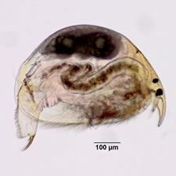
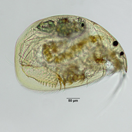
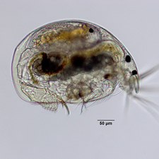

**Your specimen belongs the Genus: Alona**

Below are some examples of species within Genus Alona

[Alona bicolor](old:html/Organisms/CCladocera/FChydoridae/GAlona/Alona_bicolor/alonabicolor.html)

[Alona rustica](old:html/Organisms/CCladocera/FChydoridae/GAlona/Alona_rustica/alonarustica.html)

[Alona setulosa](old:html/Organisms/CCladocera/FChydoridae/GAlona/Alona_setulosa/alonasetulosa.html)

## Taxonomy

**Phylum**

**Arthropoda**

**Subphylum**

**Crustacea**

**Class**

**Branchiopoda**

**Suborder**

**Cladocera**

**Family**

**Chydoridae**

**Genus**

**Alona**
