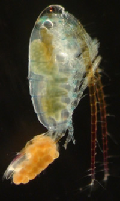

**You have identified your specimen:**

Calanoid copepod female

Your specimen is a female calanoid copepod. Identification from this point forward in the key uses distinguishing features found only on male individuals.

If you have or can obtain another specimen that has a  
geniculate right antenna, click [here](old:html/choices/copepoda/25/25.html) to continue identification.

## Taxonomy

**Phylum**

**Arthropoda**

**Subphylum**

**Crustacea**

**Class**

**Maxillopoda**

**Subclass**

**Copepoda**

**Order**

**Calanoida**
