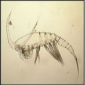

**You have identified your specimen:**

A copepod molt is the exoskeleton of a copepod, but does  
not include the entire organism.

## Taxonomy

**Phylum**

**Arthropoda**

**Subphylum**

**Crustacea**

**Class**

**Maxillopoda**

**Subclass**

**Copepoda**
