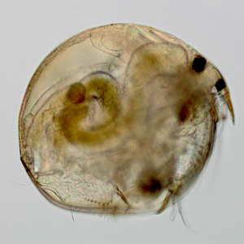
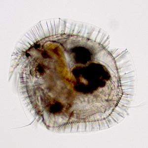

**Your specimen belongs to one of the following Genera below:**

***Chydorus, Alonella, Anchistropus, Pseudochydorus***

The most common Chydorinae species is *[Chydorus sphaericus](old:html/Organisms/CCladocera/FChydoridae/GChydorus/Chydorus_sphaericus/chydorussphaericus.html)*

An elaborate Chydorinae species is *[Chydorus bicornutus](old:html/Organisms/CCladocera/FChydoridae/GChydorus/chydorus_bicornutus/chydorusbicornutus.html)*

## Taxonomy

**Phylum**

**Arthropoda**

**Subphylum**

**Crustacea**

**Class**

**Branchiopoda**

**Suborder**

**Cladocera**

**Family**

**Chydoridae**
