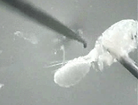
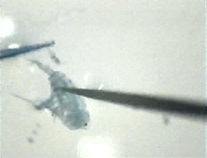
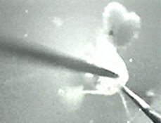

In order to properly identify copepods, it is necessary to observe specific anatomical differences of small body parts. Dissection is often necessary in order to make the required observations.

We have provided below Quicktime movies demonstrating dissection techniques for several of the body parts commonly used in this key. 5th leg dissection is used for identifying species in Order Calanoida, while rami and antenna removal are used for identifying species in Order Cyclopoida.

The procedures illustrated here were done under a dissecting microscope.

**Click on the images below to view the movies.**  
(movies will open in a separate window)

**Rami removal (954 KB)**

**5th leg dissection (1.47 MB)**

**Antenna removal (1.38 MB)**
