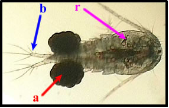
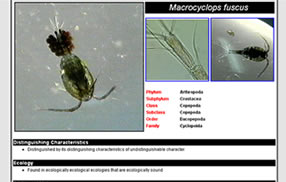
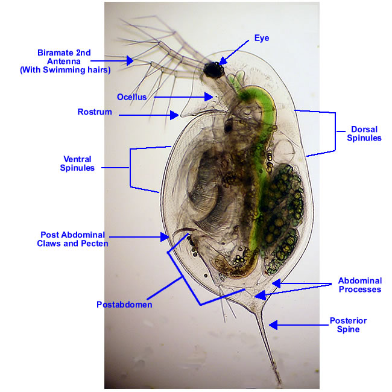

**A Note of Caution**: When identifying zooplankton, especially rotifers, natural variability and variability due to preservation techniques exists. If a specimen does not appear to fit a couplet, do not select one just because the specimen is "close enough" as you may have a new or different species. Please refer to the taxonomic [references](old:html/references.htm) if you think you have something not illustrated in the key.

This key was developed with the purpose of identifying zooplankton species, using images along with text descriptors to distinguish one species from another. Each page presents multiple choices that will eventually narrow the identification down to a species. To make a choice, simply click on the image that best resembles your specimen.

**Three ways to navigate through this key:**

**1) Identify an unknown organism.** Clicking on the [Use the Key](old:html/begin.html) button in the top banner will begin the identification process from the beginning of this key.

**2)** **Go to a species.** Clicking on the [Species](old:html/species.html) button in the top banner will open a list of the species contained in the key. Click on any of the species names to see pictures and descriptions of that organism.

**3) Go to a group.** Clicking on the [Groups](old:html/groups.html) button in the top banner will open a list of the taxonomic groups included in the key. Almost every group name has been linked to a specific point in the key at which the organism has been identified as a member of that group. Click on the group name to begin the key from that point.

**NOTE:** The Copepods do not conform to the format of this key as well as other groups included. Due to the biological variation between species of the same genus in the Suborder Copepoda, clicking on the genus name might not take you to a point where all subsequent pages are in the same genus.

Many of the images will include arrows or indicators to indicate specific organs or features on an organism. To view the image without the arrows, simply roll your mouse pointer over the image, as, for example, the image to the left.

Identification pages have been formatted in a different way so as to distinguish them from the "choice" pages. They contain pictures, taxonomic information, additional notes, video clips, and links for each species or genus.

The key also features anatomy pages for reference. The anatomy pages contain general information regarding anatomical structures for each of the major groups in the key.
