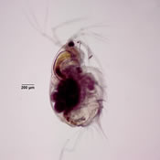
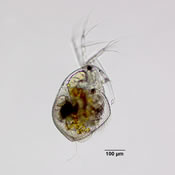
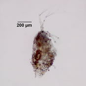
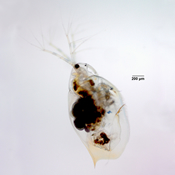
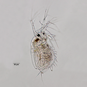
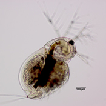

**Your specimen belongs to Family: Macrothricidae**

Below are some examples of species within family Macrothricidae

## Taxonomy

**Phylum**

**Arthropoda**

**Subphylum**

**Crustacea**

**Class**

**Branchiopoda**

**Suborder**

**Cladocera**

**Family**

**Macrothricidae**
