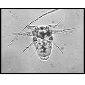
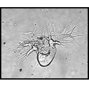
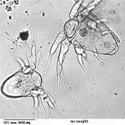
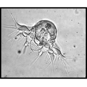
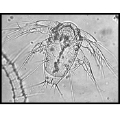
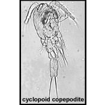
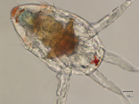

**You have identified your specimen:**

## Cyclopoid nauplius

**Phylum**

**Arthropoda**

**Subphylum**

**Crustacea**

**Class**

**Maxillopoda**

**Subclass**

**Copepoda**

**Order**

****Cyclopoida****

## Distinguishing Characteristics

- Terminal setae on longest appendages are long, delicate, and sparsely spaced on terminal segments.
- Appendages are more tubular rather than flattened in shape.

## Additional Notes

- From the anterior end of the nauplius body the three paired lateral appendages are called the first antennae, second antennae, and mandibles.
- There are 6 naupliar stages. The molt from the 6th naupliar stage to the first copepodite stage results in a juvenile form having the general body shape and appendage structure of the adults. These copepodites undergo 6 additional molts the last of which is the adult stage.
- Identification to species based on morphology can only be accurately determined using features of the adults.

## Additional Pictures

## Quicktime Movies

## Links
