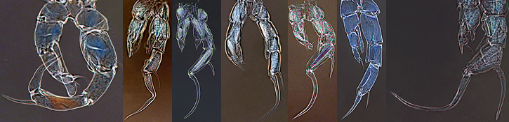
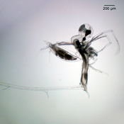
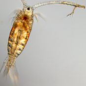
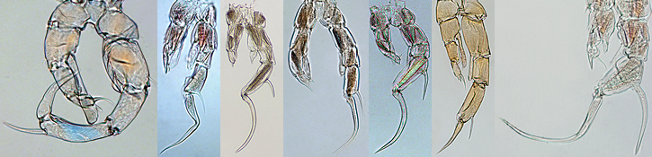

One major feature of version 5.0 is the expansion of the key to include species from across North America; the new species nearly doubled the number of calanoid copepod species represented in the key. The second major feature is the addition of numerous videos depicting aspects of zooplankton behavior and ecology. Throughout the key many improvements in the quality of images has been made. Overall, version 5.0 includes:

- Arthropod Additions:
    - Calanoida: 14 species
    - Cyclopoida: 1 species
    - Chydoridae: 1 species
    - Moinidae: 1 species
    - Bosminidae: 1 species
    - Daphniidae: 1 species
    - Cercopagididae: 1 species
    - Ergasilidae: 1 genus
    - Arguloidae: 1 genus
    - Mysidae: 1 genus

- 15 new videos on the biology and reproduction in cladocerans, copepods and rotifers were added. We listed some of our favorites below, or you can go to our [video collection](old:html/movies.html) to view all our videos.
    - Water scorpion (Nepidae) feeding on *Daphnia*: [video](video:media/nepidae/nepidae_feeding)
    - *Aglaodiaptomus leptopus* reproduction: [video](video:media/aglaodiaptomus_leptopus/aglaodiaptomus_leptopus_mating_hq)
    - *Conochilus hippocrepis* colonies in action: [video](video:media/conochilus/conochilus_hippocrepis)
    - *Alosa pseudoharengus* (alewife) feeding on *Daphnia*: [video](video:media/alosa_pseudoharengus/alewife_feeding)

- The calanoid key has been completely redesigned to accomadate the new species additions

- Nine cladoceran choice pages have been updated with new images

- Improved images added or replaced on 22 species pages

**The key now includes 244 taxa, with 113 rotifers and 131 arthropods.**

